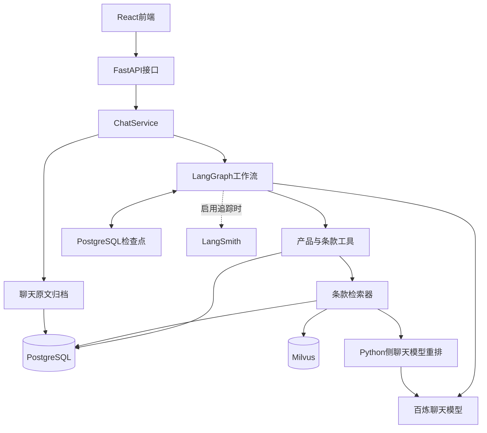
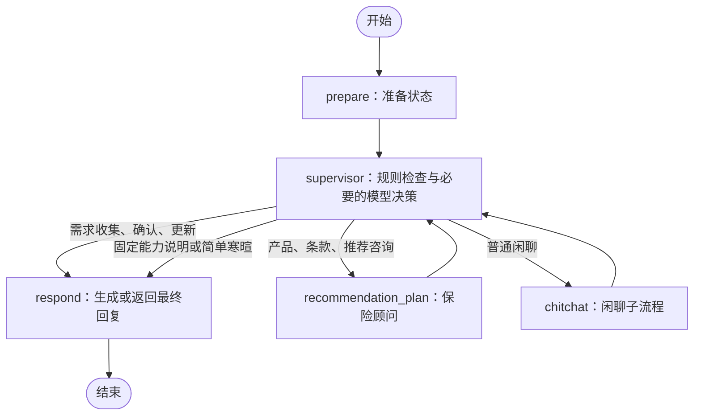
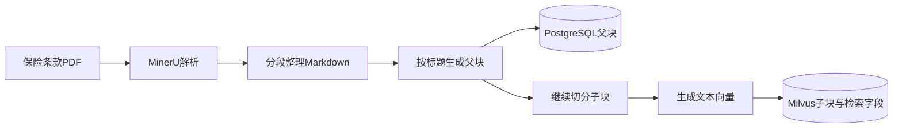

# 安心保保险咨询 Agent 项目说明

安心保是一个面向保险咨询场景的前后端分离项目，支持产品浏览、多轮咨询、需求信息更新和保险条款查询。系统通过 Supervisor 分配任务，由保险顾问调用产品、条款工具，再统一生成面向用户的回复。

项目的核心是把用户需求、产品数据、条款证据、会话状态和测评结果连接起来。它目前属于本地开发与演示项目，真实投保、核保、支付、理赔办理和人工客服转接尚未形成完整业务闭环。

本文解释项目原理与代码职责。环境安装、启动命令和源码发布注意事项见 [README](README.md)。

## 1. 项目能做什么

| 能力 | 当前实现 |
| --- | --- |
| 产品浏览 | 按险种查询上架产品，展示产品目录信息 |
| 需求收集 | 围绕预算、年龄、保障对象、健康情况、保额与期限等信息继续追问 |
| 信息更新 | 在同一会话中处理预算、保障对象等条件的修改 |
| 产品初筛 | 根据险种、目录最低保费等条件查询候选产品 |
| 条款问答 | 检索指定产品的条款，结合返回的章节与正文组织回答 |
| 会话管理 | 新建、查询、重命名、删除会话，并恢复历史消息 |
| 流式回复 | 使用 SSE 将最终回复逐步发送给前端 |
| 效果测评 | 使用固定题库执行完整 Agent，记录回答、工具调用、耗时和聊天模型用量 |

产品目录中的最低保费是筛选信息，不能直接当作某位用户完整投保方案的实际报价。查询到条款也不等于已经完成核保或确认能够赔付。

## 2. 技术架构

| 层次 | 技术 | 在项目中的作用 |
| --- | --- | --- |
| 前端 | React、TypeScript、Vite、Ant Design | 产品页面、聊天交互、会话列表和回复展示 |
| HTTP服务 | FastAPI | 提供产品、会话与流式聊天接口 |
| 工作流 | LangGraph | 定义节点、路由、执行状态与会话检查点 |
| 模型与工具 | LangChain | 调用聊天模型、绑定工具、处理结构化输出和摘要 |
| 聊天模型 | 百炼的OpenAI兼容接口 | 主管决策、保险顾问、最终回复、历史摘要与条款重排 |
| 关系数据库 | PostgreSQL、SQLAlchemy | 产品目录、条款父块、会话、聊天原文等数据 |
| 状态持久化 | PostgreSQL Checkpointer | 保存LangGraph会话状态，支持跨请求恢复 |
| 检索 | Milvus | 稠密向量与BM25稀疏检索 |
| 文档解析 | MinerU | 将保险条款PDF转换为可处理文本 |
| 观测与测评 | LangSmith | 调用追踪、题库管理、实验记录与评分 |
| 本地基础设施 | Docker Compose、etcd、MinIO | 启动PostgreSQL、Milvus及相关依赖 |

聊天模型由`CHAT_MODEL`配置。代码使用`ChatOpenAI`这个客户端类，是为了调用兼容接口；实际模型服务取决于项目配置，并不由客户端类名决定。



## 3. 一条聊天消息如何处理

以用户发送“预算改成每年3000元，其他情况不变”为例：

1. 前端提交会话标识`thread_id`和本轮消息。
2. 后端根据请求携带的用户标识检查会话归属。
3. `ChatService`归档原有消息和本轮用户消息。
4. LangGraph根据`thread_id`恢复该会话的执行状态。
5. `prepare`清空上一轮内部任务结果，保留对话上下文；达到阈值时进行摘要。
6. 主管判断本轮只需更新信息，选择`direct_response`。
7. `respond`结合历史与最新修改生成回复。
8. 最终回复通过SSE发送给前端，并保存到聊天历史中。

这类请求不需要先查产品或条款。若用户同时要求“预算改成3000元，并查询某款产品的等待期”，仍应进入保险顾问与检索流程。

## 4. Supervisor与子Agent如何协作

### 4.1 主工作流

主图定义在 [orchestrator.py](agent-service/app/agents/orchestrator.py)。



`direct_response`是主管选择的一种路由结果，不是额外执行的子Agent节点。它会直接跳到`respond`。

### 4.2 三个容易混淆的概念

| 概念 | 含义 |
| --- | --- |
| 工作流节点 | 一段真实的Python处理逻辑，例如`prepare`、`supervisor`、`respond` |
| 模型调用 | 节点或工具内部向模型服务发出的一次请求 |
| 子Agent | 由模型、工具和内部执行循环组成的子流程 |

进入`supervisor`节点，不一定会调用主管模型。该节点会先执行程序规则：

- 子Agent返回`completed`：直接进入最终回复。
- 子Agent返回`needs_user_input`：直接组织追问，等待用户补充。
- 子流程发生递归上限错误：停止本轮自动重试。
- 可重试失败：在委派上限、重复任务检查等约束下，才继续让主管决定是否补查。

子Agent不需要主动“调用主管”。它执行完成后，是LangGraph预先定义的边将流程带回主管节点。

### 4.3 主管和保险顾问分别返回什么

主管通过`SupervisorDecision`返回下一步选择、任务和理由。保险顾问通过`WorkerResult`返回内部结果：

| 字段 | 含义 |
| --- | --- |
| `status` | 已完成、需要用户补充，或执行失败 |
| `result` | 任务结论 |
| `missing_fields` | 尚缺的用户信息 |
| `sources` | 实际查询到的来源线索 |

这些结构定义在 [schemas.py](agent-service/app/agents/schemas.py)。内部结果用于组织最终回复，不直接拼接成用户聊天记录。

### 4.4 为什么单独保留respond节点

保险顾问可能产生工具调用、内部草稿和结构化结果。前端只应展示面向用户的最终答案。

[ChatService](agent-service/app/modules/chat/service.py)按事件元数据过滤消息，只转发`respond`节点产生的公开回复，并排除内部摘要。固定寒暄和未接入能力的说明，也经过这个统一出口返回。

## 5. RAG知识库如何建立

RAG的作用是先找到相关资料，再让模型依据资料回答。项目的入库流程在 [pipeline.py](agent-service/app/rag/pipeline.py)。



### 5.1 为什么使用父块与子块

子块较短，便于找到与问题直接相关的内容；父块保留较完整的章节，便于回答时理解前提、限制和上下文。

当前代码按Markdown标题生成父块，再以500字符、50字符重叠的配置切分子块。子块正文补充章节路径，并携带`product_id`、`parent_id`，用于限定产品和回查父块。

### 5.2 向量模型与聊天模型各做什么

向量模型把文本转成用于相似度检索的数字向量。聊天模型负责决策、解释和生成回复，两者用途不同。

[embeddings.py](agent-service/app/infra/embeddings.py)提供两条配置分支：

- `dashscope`：当前云端适配器使用`qwen3-vl-embedding`，通过百炼原生接口生成向量。
- `ollama`：使用本机Ollama服务提供的向量模型。

云端适配器虽然使用多模态接口，这条入库链路传入的仍是文本，不代表项目已经实现图片问答。切换模型或向量维度时，还需要保证目标集合与已有数据兼容。

### 5.3 缓存与重复导入

项目缓存PDF解析结果和分段整理结果。缓存与文件内容、模型及整理规则有关，重复处理时可以复用，减少外部调用。

导入脚本会检查产品是否已完整入库，并跳过已完成产品。整理提示词要求保留正文、不改写条款；解析和模型整理的准确性仍应通过原文抽查验证。

## 6. 一次条款查询如何完成

保险顾问的两个业务工具定义在 [tools.py](agent-service/app/agents/tools.py)。

| 工具 | 数据来源 | 用途 |
| --- | --- | --- |
| `query_candidate_products` | PostgreSQL产品目录 | 按险种、目录最低保费等条件初筛产品 |
| `retrieve_insurance_clause` | Milvus与PostgreSQL条款库 | 查询指定产品的相关条款 |

条款检索由 [retriever.py](agent-service/app/rag/retriever.py)执行：

1. 根据问题和`product_id`在Milvus中检索候选子块。
2. 使用稠密向量与BM25稀疏字段进行混合召回，当前最多取10个候选。
3. Python调用`ChatModelReranker`，按问题相关性重排候选子块。
4. 根据重排后选中的子块，去重得到父块标识。
5. 从PostgreSQL取回较完整的父块正文。
6. 将章节路径和正文交给保险顾问，组织有依据的回答。

### 当前重排的实际实现

当前重排由 [reranker.py](agent-service/app/infra/reranker.py)中的Python代码调用聊天模型完成，模型返回候选片段的编号顺序。

Milvus负责检索候选；重排请求由Python服务发往所配置的聊天模型。此链路没有使用Milvus服务端原生的云端重排功能，也没有调用独立的专用Rerank模型接口。

因此，LangSmith的条款工具内部会出现聊天模型调用，并消耗聊天token。重排失败时，程序保留基础检索顺序继续返回结果。

## 7. 多轮记忆、摘要与聊天记录

项目把三类数据分开管理：

| 数据 | 保存位置 | 主要作用 |
| --- | --- | --- |
| LangGraph状态 | PostgreSQL检查点 | 恢复同一会话的消息和工作流状态 |
| 公开聊天原文 | PostgreSQL聊天消息表 | 页面展示完整的用户消息与最终回复 |
| 内部历史摘要 | 工作流消息状态 | 压缩过长上下文，降低后续模型输入量 |

`thread_id`用于区分会话。模型处理后续消息时，可以从检查点恢复此前状态。

达到摘要阈值后，[context.py](agent-service/app/agents/context.py)先归档原文，再压缩较早对话。摘要标记为内部上下文，不作为真实用户发言，也不展示到前端。摘要失败、为空或输出不完整时保留原状态。

历史页面读取独立归档的原文，所以模型上下文压缩后，页面历史不会因此只剩一段摘要。

“沿用最新预算”主要依靠对话状态、摘要规则和模型理解完成。当前并非所有需求字段都实现了独立、严格的结构化更新，因此仍需测评预算修改、保障对象切换等场景。

## 8. 数据库与接口职责

PostgreSQL保存产品目录、条款父块、会话与消息，并通过独立检查点机制保存工作流状态。Milvus保存检索所需的向量、稀疏字段及关联元数据。

当前后端挂载的核心接口如下：

| 方法 | 路径 | 用途 |
| --- | --- | --- |
| GET | `/health` | 健康检查 |
| GET | `/api/v1/products` | 查询产品列表 |
| GET | `/api/v1/products/candidates` | 初筛候选产品 |
| POST | `/api/v1/chat-threads` | 新建会话 |
| GET | `/api/v1/chat-threads` | 查询会话列表 |
| PATCH | `/api/v1/chat-threads/{thread_id}` | 修改会话标题 |
| DELETE | `/api/v1/chat-threads/{thread_id}` | 删除会话及相关历史、检查点 |
| GET | `/api/v1/chat-threads/{thread_id}/messages` | 获取聊天历史 |
| POST | `/api/v1/chat` | 发起流式聊天 |

会话接口使用请求头`x-user-id`并检查会话归属。这是当前演示环境的身份传递方式，不能单独作为真实用户身份认证。

前端中存在投保页面、方案及相关接口调用的预留代码，数据库也包含相应业务结构。它们不等于当前FastAPI后端已经提供了完整的报价、订单、核保或保单服务。

## 9. 项目如何测评

### 9.1 使用模拟模型检查代码逻辑

测试用`AsyncMock`等替身替换模型或子Agent，让它们返回指定结果，再运行真实的图节点、条件判断和状态更新。

例如：让子Agent固定返回`completed`，检查程序是否直接进入`respond`、有没有额外调用主管模型；让替身抛出递归错误，检查是否停止重试。

这类测试验证“程序收到某种结果后如何处理”，不验证真实模型能否理解用户问题。相关文件见 [test_supervisor_workflow.py](agent-service/tests/test_supervisor_workflow.py)和 [test_conversation_context.py](agent-service/tests/test_conversation_context.py)。

### 9.2 使用真实模型执行固定题库

当前主要测评方式是：

```text
LangSmith保存题目与参考标准
          ↓
本机SDK读取题目
          ↓
真实运行ChatService与完整Agent
          ↓
上传回答、各轮工具证据、耗时和聊天模型用量
          ↓
Dataset关联的云端评委评分
```

正式入口是 [evaluate_langsmith.py](agent-service/scripts/evaluate_langsmith.py)。多轮题在同一测试会话中顺序执行，不同题使用独立会话，运行结束后清理临时数据。

参考答案只提供给评估器，不传给被测Agent。实验输出中的`evaluation_record`按轮整理用户输入、实际回复与工具证据，避免评委误把内部草稿当成最终回答。

### 9.3 运行成功与业务通过分别统计

| 指标 | 含义 |
| --- | --- |
| `execution_complete` | 所有输入轮次正常结束并返回非空回复 |
| `cleanup_complete` | 测试会话及检查点清理成功 |
| 云端业务评分 | 回答是否满足参考要点、遵守限制并具备必要依据 |
| 模型调用与token | 已采集聊天模型的调用量和输入、输出用量 |
| 首字与总耗时 | 用户等待时间以及执行过程耗时 |

有回复不代表业务正确；评委给分也需要人工复核。LangSmith追踪树中的节点记录数包含图节点、模型包装、工具和解析器，不等于真实模型调用次数。

## 10. 已完成的调度优化与实测记录

项目曾出现“用户只问还缺哪些信息，系统却安排产品推荐和反复条款查询”的情况。已完成两项调整：

1. 增加需求收集、信息确认与更新的直接回复路径。
2. 子Agent完成后直接收尾；需要用户补充时结束本轮；递归错误后停止自动重跑。

2026年11月26日，使用同一份十题合成题库和同一评委配置，各题运行一次，记录如下：

| 指标 | 优化前 | 优化后 |
| --- | ---: | ---: |
| 完整执行与清理 | 10/10 | 10/10 |
| 自动业务评分通过 | 9/10 | 10/10 |
| 聊天模型调用 | 74次 | 46次 |
| 聊天token合计 | 119,180 | 75,683 |
| 十题累计耗时 | 240.3秒 | 150.9秒 |

这轮聊天token减少约36.5%，累计耗时减少约37.2%。其中，已知信息后的追问题从18次模型调用、8次工具调用，降为2次模型调用、0次工具调用。

这是一次小题库实验的结果，不代表生产准确率或稳定性能承诺。token统计不包含云端评委、向量化等全部外部服务用量；累计耗时包含测试清理，多轮题则合计多个轮次。

人工复核仍发现追问标准解释有波动、投保人与被保险人标签表述不够清晰等细节；健康告知题本轮的调用量也增加了。因此，自动评分全部通过仍不能解释为项目所有细节均已正确。

原始实验记录只保留在本地或所属工作区，公开说明不附带私人工作区链接和运行标识。

## 11. 主要代码阅读顺序

| 建议顺序 | 文件 | 重点 |
| --- | --- | --- |
| 1 | [main.py](agent-service/app/main.py) | 服务启动、资源初始化与路由挂载 |
| 2 | [chat/service.py](agent-service/app/modules/chat/service.py) | 会话归属、状态恢复、消息归档与SSE |
| 3 | [orchestrator.py](agent-service/app/agents/orchestrator.py) | 主图节点、跳转和停止条件 |
| 4 | [supervisor.py](agent-service/app/agents/supervisor.py) | 主管决策与最终回复提示词 |
| 5 | [insurance_advisor.py](agent-service/app/agents/insurance_advisor.py) | 工具绑定与结构化子Agent结果 |
| 6 | [tools.py](agent-service/app/agents/tools.py) | 产品和条款工具入口 |
| 7 | [retriever.py](agent-service/app/rag/retriever.py) | 混合召回、重排和父块回查 |
| 8 | [pipeline.py](agent-service/app/rag/pipeline.py) | 文档解析、整理、切分与入库 |
| 9 | [context.py](agent-service/app/agents/context.py) | 摘要与原文归档保护 |
| 10 | [evaluation目录](agent-service/app/evaluation/) | 题库、运行采集和评分材料 |

## 12. 当前边界与后续方向

- **业务闭环**：真实投保、核保、支付、理赔办理和人工转接仍需接入实际系统。
- **身份与授权**：演示身份和用户标识请求头需要升级为可信认证，并完善接口授权。
- **需求管理**：可进一步结构化保存年龄、预算、保障对象等字段，降低角色混淆和信息更新错误。
- **检索成本**：可继续验证重复查询复用、工具调用预算及更合适的重排方式。
- **评分可靠性**：扩充题库，明确必答与可选要点，用人工正反例校准评委，并按指标拆分得分。
- **资料与隐私**：真实凭据、本机配置、聊天、日志、原始文档与实验报告通过忽略规则排除；开启追踪或真实测评前需确认上传内容。

这个项目可以概括为：使用LangGraph编排保险咨询工作流，通过PostgreSQL与Milvus提供产品和条款依据，借助检查点和原文归档支持多轮对话，再通过LangSmith观察执行过程、测量效果并改进成本。
